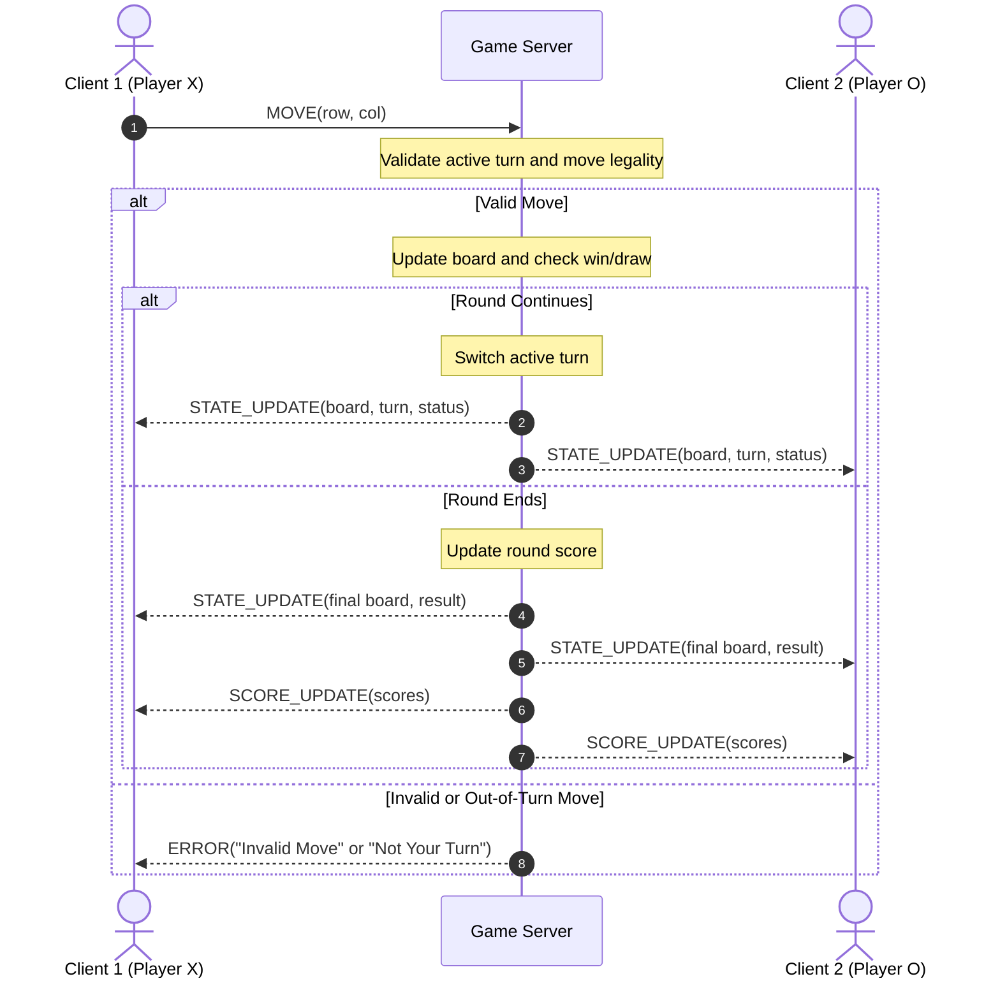

# Sprint 2: Game Behavior & Server Concurrency Architecture Design

## 1. Server Concurrency Architecture

The Tic-Tac-Toe server will use non-blocking I/O with Python's `selectors` module. This allows the server to manage multiple TCP connections without blocking the main server loop while waiting for one client.

The listening socket will be placed in non-blocking mode and registered with the selector. When the selector reports that the listening socket is ready, the server will accept the new connection, place the client socket in non-blocking mode, and register it for read events.

```python
sock.setblocking(False)
```

The server will support at least two simultaneous player connections. The first player will be assigned `X` and the second player will be assigned `O`. If another player attempts to join while both player slots are already in use, the server can return a game-full response and close that connection.

During the game, the main event loop will call `selector.select()` and service whichever client sockets are ready. Incoming messages are read and processed without stopping the server from handling the other client.

When the server has data to send, the response is placed in that client's outgoing buffer and the socket is serviced when it becomes ready for writing.

If a client disconnects, the server will unregister the socket from the selector, close it, and remove the client from the active player state.

The connection lifecycle is:

1. Create and register the listening socket.
2. Accept a client connection.
3. Set the client socket to non-blocking mode.
4. Register the client with the selector.
5. Assign the client to Player 1 or Player 2.
6. Service client messages through the main event loop.
7. Send game-state updates through the client's output buffer.
8. Unregister and close the socket when the client disconnects.

## 2. State Isolation and Concurrency Safety

The server will be the only authority allowed to modify the shared game state.

The shared state includes:

- Game board
- Current turn
- Player assignments
- Connected client sockets
- Game status
- Round scores
- Outgoing client message buffers

The server uses one event-loop thread, so two threads cannot modify the board or scores at the same time. Because of this, a `threading.Lock` is not required for this design.

Each move is handled as one complete state operation. The server first validates the move, then updates the board, checks for a win or draw, changes the turn if needed, and queues the updated state for both clients before processing another move request.

This keeps a second client event from changing the shared game state in the middle of another move.

## 3. Move Validation and Turn Synchronization

Player 1 uses `X` and moves first. Player 2 uses `O`.

When a client sends a move, the server checks:

1. The request came from the player whose turn it is.
2. The row and column are valid.
3. The selected cell is empty.
4. The round is still active.

If the move passes validation, the server updates the board and checks whether the move caused a win or draw.

If the round continues, the server switches the active turn to the other player.

The same `STATE_UPDATE` is then queued for both connected clients before the server processes the next move. This keeps both clients synchronized with the server's board and turn state.

If the move is invalid or comes from the wrong player, the server sends an `ERROR` response to that client and leaves the shared game state unchanged.

## 4. State and Score Broadcast Sequence Diagram



## 5. Score and Leaderboard Synchronization

The server will store the current scores in memory for the active game session.

```python
scores = {
    "Player1": 0,
    "Player2": 0
}
```

When a player wins a round, the server increments that player's score. A draw does not increase either score.

After the round is completed, the server queues the same updated score information for both connected clients.

Example:

```text
SCORE_UPDATE Player1=1 Player2=0
```

Clients do not calculate or modify their own scores. The server remains the authoritative source for the scoreboard.

The next round will not begin until the completed round state and updated scores have been prepared for both clients.

## 6. Design Summary

The server uses `selectors` and non-blocking sockets to handle both players without blocking the main loop.

Shared game state is isolated inside one event-loop thread. The server validates each move before changing the board and finishes the complete validation, state update, and broadcast process before servicing another move.

Both clients receive the same board, turn, round result, and score information from the server.
