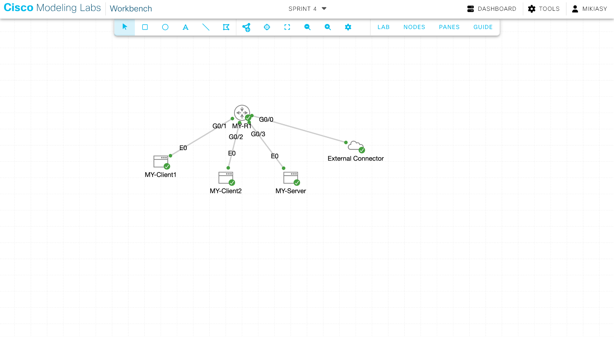
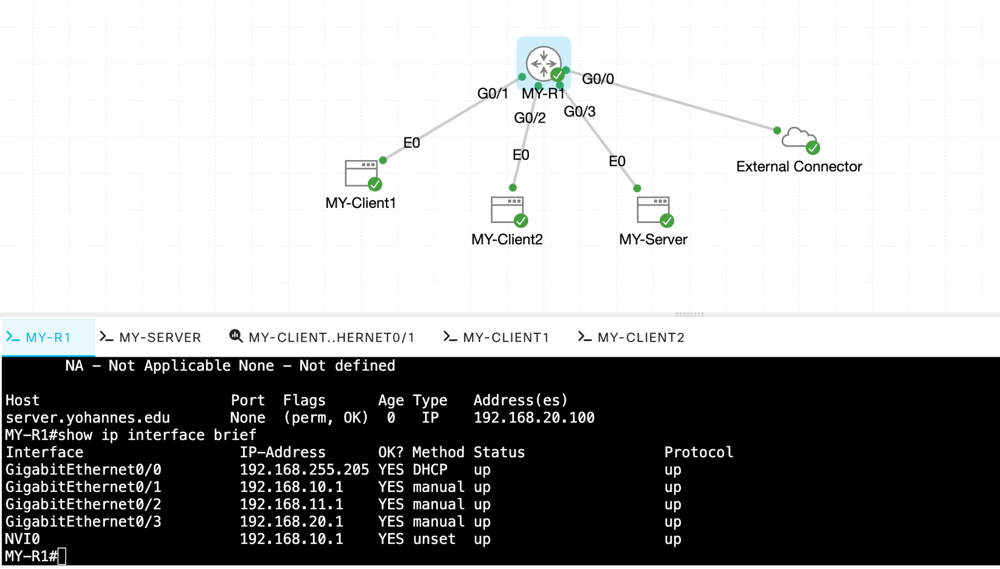
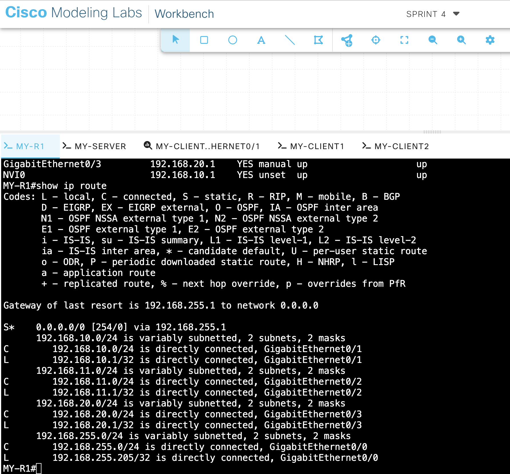
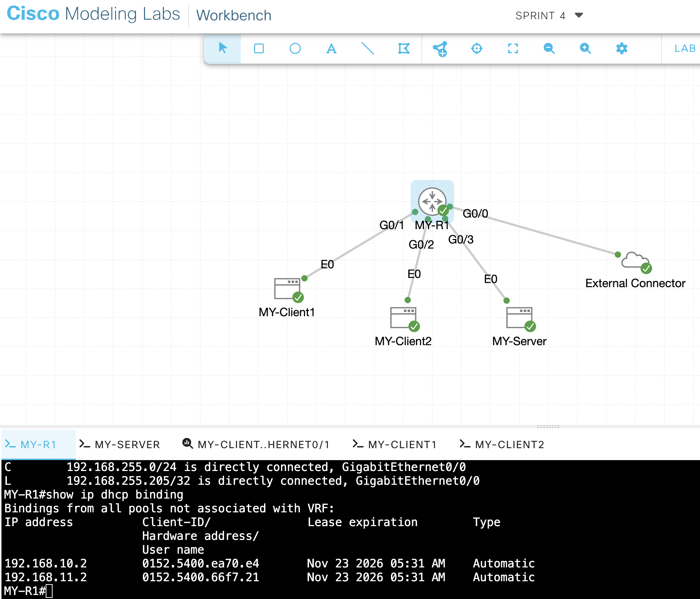
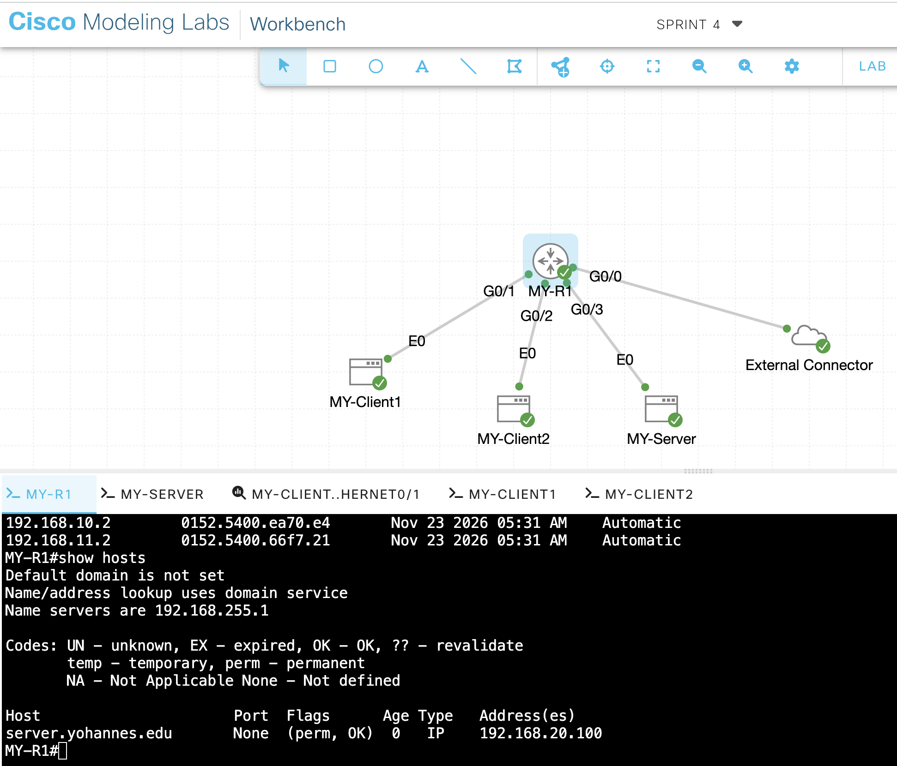
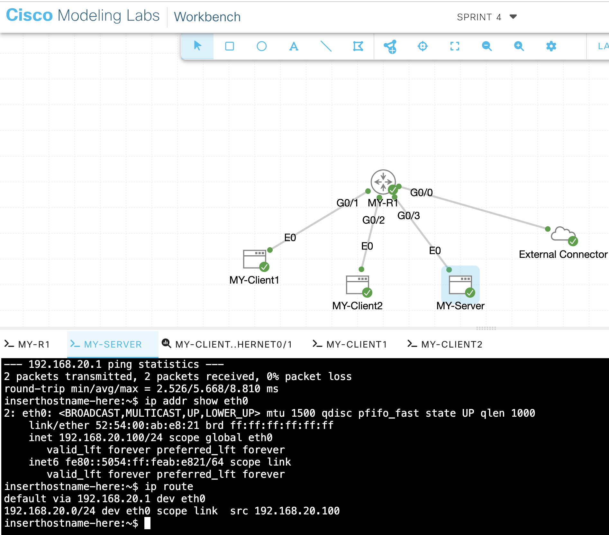
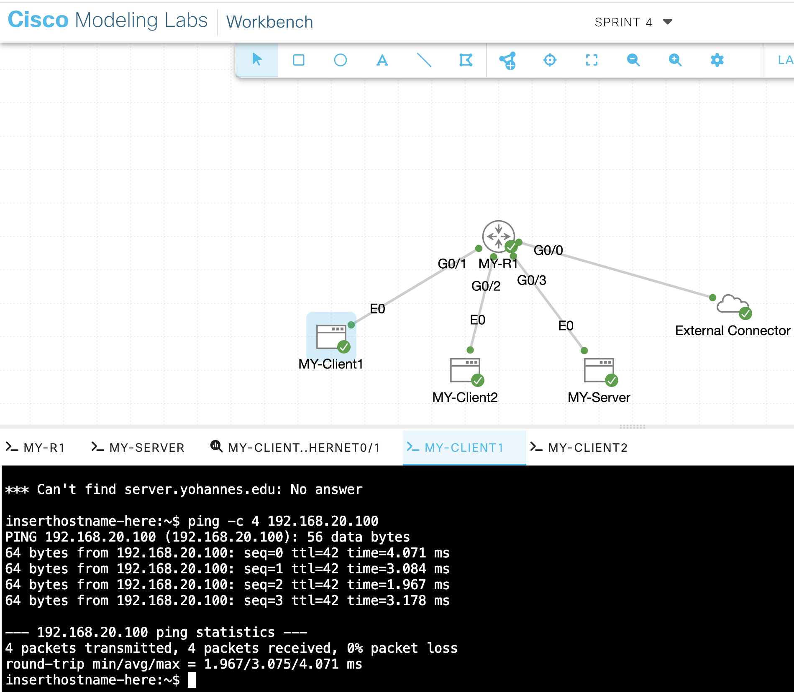
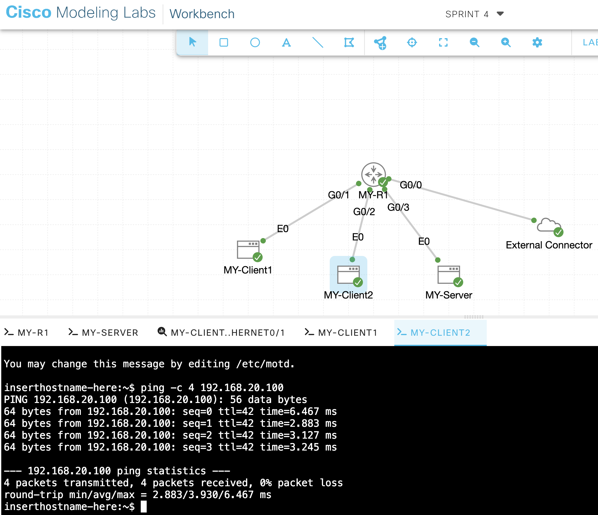
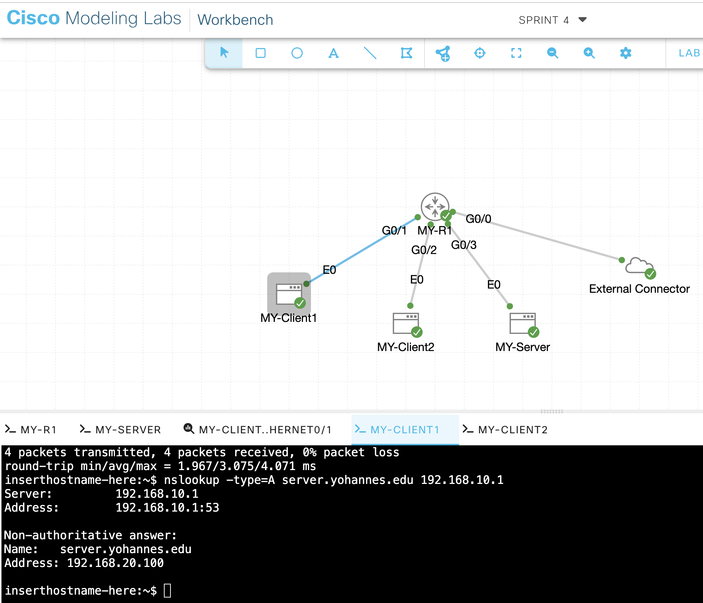
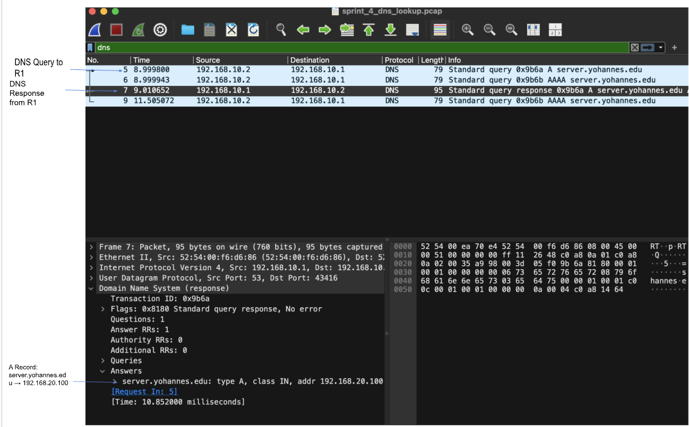

# Sprint 4 Network Verification Report

**Name:** Mikias Yohannes  
**Course:** CS457  
**Sprint:** Sprint 4 – CML 1-Router Network Topology & Infrastructure Deployment

## 1. Network Topology

Sprint 4 has been created within Cisco Modeling Labs. It contains:

- 1 Cisco IOS Router
- 2 Client Nodes
- 1 Game Server
- 1 External Connector

Within the network there are 3 subnets:

- Client 1: `192.168.10.0/24`
- Client 2: `192.168.11.0/24`
- Game Server: `192.168.20.0/24`

R1 is connected to all three subnets and to the External Connector.

## 2. Router Interface Configuration

R1 has been configured with:

- GigabitEthernet0/1: `192.168.10.1/24`
- GigabitEthernet0/2: `192.168.11.1/24`
- GigabitEthernet0/3: `192.168.20.1/24`
- GigabitEthernet0/0: Assigned IP `192.168.255.205` via DHCP from external network.

All interfaces have a status of up/up.

## 3. Routes Confirmed

All 3 internal networks are shown as directly connected on R1.

A default route has also been provided to `192.168.255.1` to allow routing out of the External Connector.

## 4. DHCP Confirmed

The Router had 2 different DHCP pools configured.

- `CLIENT1_POOL` – `192.168.10.0/24`
- `CLIENT2_POOL` – `192.168.11.0/24`

Leases were issued:

- MY-Client1: `192.168.10.2`
- MY-Client2: `192.168.11.2`

## 5. DNS Configuration

R1 is being used as a DNS server.

The game server name was configured as:

`server.yohannes.edu`

with the IPv4 address:

`192.168.20.100`

This can be confirmed by checking the hosts table on the router.

## 6. Game Server Configuration

The game server has been correctly configured with static IP:

- IP Address: `192.168.20.100/24`
- Default Gateway: `192.168.20.1`

The game server can communicate with the R1 gateway.

## 7. Communication Between Subnets

MY-Client1 can communicate with the game server at `192.168.20.100`.

Ping results:

`4 packets transmitted, 4 packets received. 0% packet loss.`

MY-Client2 can communicate with the game server at `192.168.20.100`.

Ping results:

`4 packets transmitted, 4 packets received. 0% packet loss.`

This confirms that R1 is correctly routing traffic between all 3 internal subnets.

## 8. DNS Resolution Confirmed

Using nslookup from MY-Client1:

`nslookup -type=A server.yohannes.edu 192.168.10.1`

A correct DNS result was given from DNS Server `192.168.10.1`:

`server.yohannes.edu → 192.168.20.100`

## 9. DNS Confirmed Using Wireshark

Packet capture was done on link between MY-Client1 and R1.

Within the capture we can see:

- DNS query from `192.168.10.2` to `192.168.10.1`
- DNS response from `192.168.10.1` to `192.168.10.2`
- DNS on UDP port 53
- A resource record was sent back mapping `server.yohannes.edu` to `192.168.20.100`

## 10. Confirmation

The network topology for Sprint 4 has been correctly implemented.

R1 provides connections between the 3 required internal subnets. It provides DHCP addresses for both client nodes, DNS resolution for the game server name, and routing between clients and game servers.

Both clients were able to communicate with the game server with 0% packet loss. From the packet capture of DNS queries, it has been confirmed that `server.yohannes.edu` does resolve to `192.168.20.100`.
